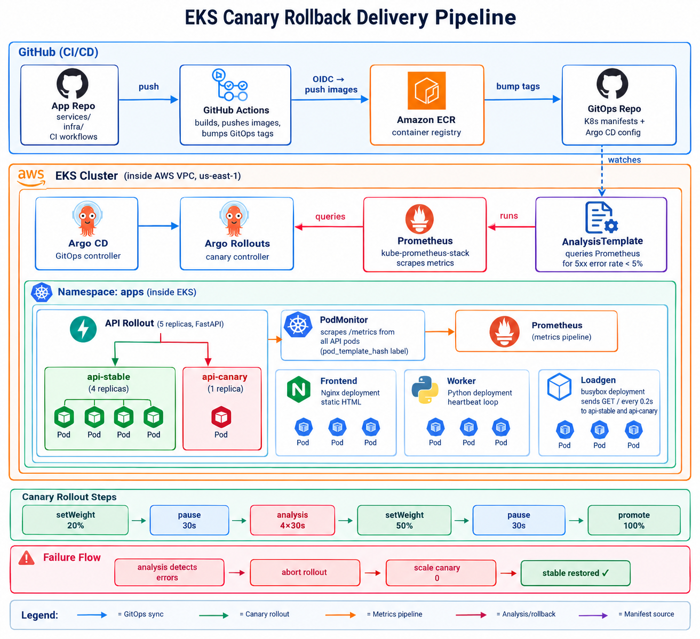

# EKS Canary Rollback

A GitOps canary delivery pipeline on Amazon EKS with automated rollback driven by Prometheus metrics.

## Architecture



## Architecture

GitHub Actions CI
push to main → build images → push to ECR → update gitops repo
│
▼
GitOps repo ──► Argo CD ──► EKS cluster
│
┌───────────────────┼───────────────────┐
│ │ │
Argo Rollouts Prometheus stack Workloads
(canary steps) (scrapes /metrics) api(Rollout)
│ │ frontend
└───── queries ─────┘ worker
5xx error rate loadgen


## How the canary works

The API uses an Argo Rollouts Rollout instead of a Deployment. On each new revision:

1. 20% traffic — 1 of 5 pods replaced with canary, 30s pause
2. Analysis — Prometheus checks canary 5xx rate over 4x30s intervals, threshold < 5%
3. 50% traffic — if analysis passes, 30s pause
4. 100% traffic — full promotion

If 5xx rate exceeds 5%, the Rollout aborts and removes the canary pod automatically.

This is a pod-count canary (no service mesh required). Traffic split is proportional to pod count.

## Repository structure

- `.github/workflows/deploy.yml` — CI: build, push to ECR, update gitops
- `.github/workflows/secret-scan.yml` — gitleaks on push/PR
- `infra/bootstrap/` — Terraform: S3 state bucket, budget alarm
- `infra/cluster/` — Terraform: VPC, EKS, ECR, GitHub OIDC
- `infra/platform/` — Terraform: Argo CD helm release
- `services/api/` — FastAPI app with /metrics endpoint
- `services/frontend/` — Nginx static page
- `services/worker/` — Python heartbeat service
- `scripts/demo.sh` — Toggle FAIL_RATE for canary demo
- `scripts/down.sh` — Teardown all infrastructure

## Prerequisites

- AWS CLI configured with credentials
- Terraform >= 1.11
- kubectl
- GitHub App with Contents read/write on the gitops repo

## Setup

Deploy infrastructure in order:

```bash
terraform -chdir=infra/bootstrap init && terraform -chdir=infra/bootstrap apply
terraform -chdir=infra/cluster init && terraform -chdir=infra/cluster apply
aws eks update-kubeconfig --name eks-canary-rollback --region us-east-1
terraform -chdir=infra/platform init && terraform -chdir=infra/platform apply
```

Then bootstrap Argo CD:

```bash
kubectl apply -f ../eks-canary-rollback-gitops/bootstrap/root.yaml
```

## Demo

Break the canary (triggers automatic rollback):

```bash
bash scripts/demo.sh break
```

Fix it:

```bash
bash scripts/demo.sh fix
```

Watch the rollout:

```bash
kubectl -n apps get rollout api -w
kubectl -n apps get analysisrun -n apps -w
```

## Teardown

```bash
bash scripts/down.sh
```

## Related repo

- [eks-canary-rollback-gitops](https://github.com/CloudDev-x/eks-canary-rollback-gitops) — Kubernetes manifests and Argo CD configuration
